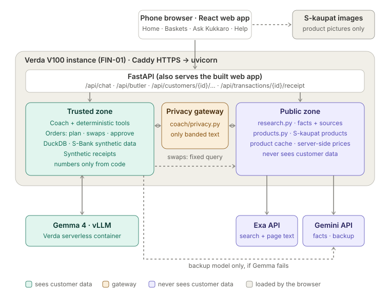

# Kukkaro system design

Kukkaro is one FastAPI backend that serves both the API and the built React web app. It runs on a
Verda instance, and its models and search APIs are called from the server. The diagram's colours show
who may see the customer's data. The rules behind it are in root `AGENTS.md` §4, and the reasons are in
`docs/DECISIONS.md`.

## The parts

| Part | Code | Sees customer data? | What it does |
|---|---|---|---|
| Web app | `web/` | the signed-in customer's own | Home (account card, recent transactions, one insight), Baskets, Ask Kukkaro (chat), Help (Butler, swaps, product cards), the planned grocery order |
| API | `backend/kukkaro/api/` | yes | FastAPI app; wires the routers below; serves `web/dist` |
| Data + tools | `backend/kukkaro/data/`, `coach/tools.py` | yes | DuckDB over the S-Bank synthetic dataset; every number is computed here in code |
| Receipts | `backend/kukkaro/receipts/` | yes | synthetic receipt line items, the essentials/leaks split, store-brand savings |
| Coach | `backend/kukkaro/coach/` | yes | Gemma 4 picks tools and explains their results; a number check rejects any number not from a tool |
| Orders | `backend/kukkaro/orders/` | yes | concept "order my usual groceries": plan, store-brand swaps, Butler extras, approve; prices computed in code |
| Privacy gateway | `backend/kukkaro/coach/privacy.py` | checks it | blocks IDs, postal codes, exact amounts and ages, names, emails and phone numbers; only rounded or banded context leaves |
| Research | `backend/kukkaro/butler/research.py` | **no** | Exa search + page text; Gemini writes facts only from those pages, with a source per fact |
| Products | `backend/kukkaro/butler/products.py` | **no** | real S-Group products from S-kaupat product pages: name, picture, page price parsed in code; cached server-side by id |
| Gemma 4 | Verda serverless container (vLLM, OpenAI-compatible) | yes | the trusted-zone model (`GEMMA_BASE_URL`, `GEMMA_API_KEY`) |
| Gemini | Google API | backup only | facts in the public zone; answers a turn only when Gemma fails ("Backup model used") |
| Exa | Exa API | **no** | web search and page contents for research and products |

## Request flows

- **Home and Baskets.** `GET /api/customers/{id}/transactions` and `/summary` read DuckDB, and
  `GET /api/transactions/{tx_id}/receipt` returns a grocery payment's synthetic receipt. No model is
  called.
- **Ask Kukkaro.** `POST /api/chat`: Gemma runs tools over the customer's data. If it needs outside
  facts, it calls `research_web(question)`, which goes through the gateway to the public zone and
  comes back as `{facts, sources}`.
- **Help (Butler).** `POST /api/butler` sends the task through the gateway as one anonymised question.
  Grocery questions also return product cards (S-kaupat pages only) that can be added to the order.
  `GET /api/customers/{id}/butler/suggestions` only reads the customer's data.
- **Store-brand swaps.** `GET /api/customers/{id}/swaps`: the receipts pick the top branded items and
  each item's store-brand twin. For each twin, the public zone searches S-kaupat with a **fixed query from
  the static map** `TWIN_QUERIES` (for example "Rainbow maito 1 l"). No customer text, ID or amount
  goes into that query, so it does not need the gateway. The saving comes from the receipts, and the
  product price comes from the S-kaupat page; the two are never mixed.
- **Grocery order.** `GET /api/customers/{id}/grocery-order?swap=…&extra=…` and `POST …/approve`.
  The browser sends product **ids** only, and the server prices them from its product cache, so a
  price sent by the browser is never trusted. Delivery fees are concept example values.
- **Pictures.** Product pictures load in the browser directly from S-kaupat's image URLs. Only the
  picture is fetched, and no customer data goes with it.

## Deployment

- One Verda instance, `kukkaro-demo-2` (1× V100 Spot, FIN-01), at
  https://135.181.63.207.compute.verda.run.
- Caddy terminates HTTPS with an automatic certificate and proxies to uvicorn on `127.0.0.1:8000`,
  run as the systemd unit `kukkaro.service`.
- `deploy/deploy_demo.sh <host> <key>` uploads the built web app and a filtered `.env`, then runs
  `deploy/remote_setup.sh`.
- The instance's GPU is not used yet; Gemma runs in the separate Verda serverless container.
- **Current status (15 Nov):** `GEMMA_API_KEY` is still empty on the demo, so Gemma calls fail and
  Gemini answers as the backup. Add the key from Verda Credentials and redeploy to switch the demo
  back to Gemma.

## What changed since the first diagram (14 Nov)

- New `orders/` module (planner, swaps, approve) in the trusted zone, and `butler/products.py` with its
  product cache in the public zone.
- The swap search is a second, gateway-free path into the public zone; it is safe because the query
  text is static.
- The browser loads product pictures from S-kaupat.
- The web app has a Home tab.
- The API routes are customer-scoped (`/api/customers/{id}/…`).
- The demo moved from the CPU instance (`kukkaro-demo`) to the V100 instance, behind Caddy HTTPS.
